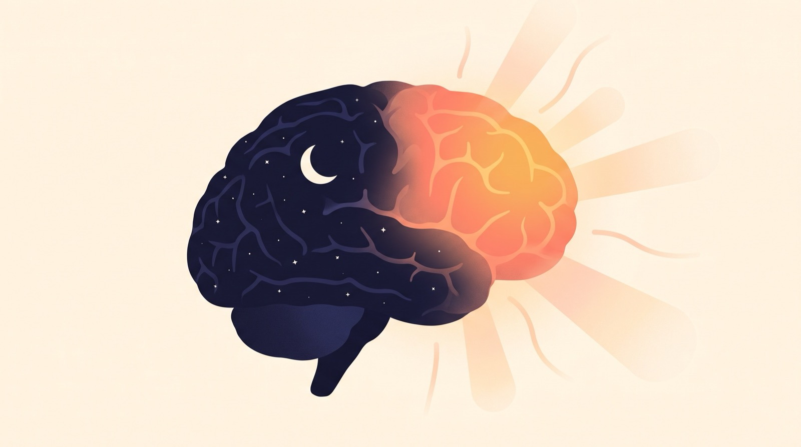

The alarm goes off. You silence it. At some point you answer a text, and later you have no memory of what it said, or of silencing the alarm at all. Twenty minutes after "waking up," you're staring into the fridge wondering what you came for.

None of that means you slept badly, and it definitely doesn't mean you're lazy. It means you were awake in the technical sense only. There's a name for this state, and it has a surprisingly deep research literature: **sleep inertia**, the transitional fog between sleep and actual alertness.

Understanding it changes how you think about mornings. Waking up isn't a switch. It's a boot sequence. And most of us are making decisions (driving, writing, joining meetings) while the system is still loading.

**The short version:** sleep inertia is the temporary grogginess, slowed thinking and clumsiness you feel right after waking up. It usually lasts 15 to 60 minutes and is worst in the first few. It runs deeper when you wake out of deep sleep, wake during your biological night, or are short on sleep. Daylight, a little movement, caffeine and a task that makes you think all shorten it. Snoozing tends to restart it.

## Your brain doesn't turn on all at once

In 2002, researchers led by Thomas Balkin used PET imaging to watch brains in the act of waking up. The result is one of the most useful facts you'll ever learn about your mornings: consciousness comes back fast, but *alertness* doesn't. The brainstem and thalamus, the deep machinery that makes you conscious at all, reactivate within minutes. The **prefrontal cortex**, the region responsible for planning, judgement, working memory and self-control, takes another 20 to 30 minutes to catch up ([Balkin et al., *Brain*, 2002](https://pubmed.ncbi.nlm.nih.gov/12244087/)).

So for [the first stretch of every morning](/blog/first-30-minutes-brain-after-waking), you are, quite literally, operating without your executive functions fully online. Your eyes are open. The CEO hasn't arrived yet.

How long the fog lasts varies. Classic work by Jewett and colleagues tracked performance after waking and found it recovers along a curve, with most of the improvement in the first hour ([Jewett et al., *Journal of Sleep Research*, 1999](https://pubmed.ncbi.nlm.nih.gov/10188130/)). A widely cited review puts the typical impairment window at **15 to 60 minutes**, stretching considerably longer after sleep deprivation or an awakening out of deep sleep ([Hilditch & McHill, *Nature and Science of Sleep*, 2019](https://pmc.ncbi.nlm.nih.gov/articles/PMC6710480/)). If you're running on a week of short nights, the fog gets deeper and lasts longer: chronic sleep restriction measurably magnifies inertia ([Sleep, 2019](https://pmc.ncbi.nlm.nih.gov/articles/PMC6519907/)).

## Sleep inertia symptoms

Sleep inertia does not feel like being tired. It feels like being slightly not there. The common signs:

- **Grogginess and a heavy head**, with a strong pull back toward the pillow.
- **Slowed reactions.** Measured on a simple reaction-time test, the drop is largest in the first minutes after waking ([what that looks like in milliseconds](/blog/morning-reaction-time-cognition)).
- **Patchy short-term memory.** Walking into the kitchen and forgetting why, or [dismissing an alarm with no memory of doing it](/blog/sleep-through-alarm-dismissed-no-memory).
- **Worse judgement and arithmetic.** Decisions that feel fine at the time and look odd an hour later.
- **Clumsiness**: the kettle that overflows, the phone that falls off the nightstand.

In an extreme form, sometimes called sleep drunkenness or confusional arousal, people wake up disoriented, confused or even aggressive for a stretch. That is uncommon and worth mentioning to a clinician if it happens often (more on that in the FAQ below).

## What causes sleep inertia

Several things stack, and they explain why some mornings are far worse than others:

1. **Waking from deep sleep.** Being pulled abruptly out of slow-wave sleep produces more inertia than waking from lighter stages ([Tassi & Muzet, *Sleep Medicine Reviews*, 2000](https://www.sciencedirect.com/science/article/abs/pii/S1087079200900984)). Deep sleep is concentrated in the first part of the night, which is why a 3 AM wake-up feels so much worse than a 7 AM one.
2. **Waking during your biological night.** In a forced desynchrony study, sleep inertia was about 3.6 times larger when people woke during their biological night than during their biological day ([Scheer et al., 2008](https://pubmed.ncbi.nlm.nih.gov/18663242/)). An alarm set well before your body clock expects morning lands right in that zone.
3. **Short or broken sleep.** Accumulated sleep debt deepens the fog and stretches it out, as the 2019 study above found.
4. **A brain that reboots in sequence.** The deep structures come back first and the prefrontal cortex last, so the circuits you need for judgement are the slowest to arrive.

## The person who dismisses your alarm isn't quite you

Here's the study that should worry anyone who trusts themselves at 6 AM. Researchers woke sleepers abruptly with a fire alarm and measured their decision-making. Performance didn't just dip. It was substantially degraded for at least **30 minutes**, and worst in the first three, exactly when the beeping thing demands a decision ([Bruck & Pisani, *Journal of Sleep Research*, 1999](https://pubmed.ncbi.nlm.nih.gov/10389091/)).

That's the core problem with ordinary alarms. Dismissing one is a decision, and it's being made by the version of you with the weakest judgement you'll have all day. Groggy-you will swipe an alarm away without forming a memory of it. Groggy-you sincerely believes the fifth snooze is different from the previous four. You're negotiating with someone who isn't fully there, and *you're* that someone.

Snoozing compounds it. Those nine-minute fragments aren't restorative sleep; they're shallow, broken dozing that can tip you back toward another sleep cycle, so the next alarm catches you descending instead of surfacing. You're not easing into the morning. You're re-running the worst part of it on a loop. (The full accounting is in [what the snooze button really costs](/blog/snooze-button-psychology-cost).)

## How to get rid of sleep inertia (or at least shorten it)

Sleep inertia is physiology, so the honest framing is *shorten and manage*, not *eliminate*. Four levers have real evidence behind them:

1. **Light, immediately.** Bright, short-wavelength light after waking speeds the recovery of alertness. Researchers have measured the effect after both natural and simulated dawn ([Sleep, 2022](https://pmc.ncbi.nlm.nih.gov/articles/PMC9787581/)). Open the curtains before you open your inbox; outside beats every bulb you own.
2. **Movement, even briefly.** In one study, a **30-second** burst of exercise at waking measurably reduced inertia and kicked the cortisol awakening response into gear ([Journal of Sleep Research, 2022](https://pubmed.ncbi.nlm.nih.gov/34606883/)). It doesn't take a workout. It takes standing up and moving like you mean it.
3. **Caffeine, with honest expectations.** Caffeine genuinely counters inertia ([Sleep, 2001](https://pubmed.ncbi.nlm.nih.gov/11683484/)), but it needs roughly 20 minutes to hit your bloodstream. The first-sip revival you feel is mostly ritual. Good ritual! Just not chemistry yet.
4. **Cognitive load, on purpose.** The prefrontal cortex is the last region to wake, and it responds to being *used*. [Working memory tasks](/blog/math-alarm-science-solving-beats-snoozing) (arithmetic, recall, sequencing) force blood flow and activation into exactly the circuitry that's lagging. It's the difference between waiting for the engine to warm up and actually driving.

Two habits make all four work better. Keep the same wake time every day, because a regular schedule means fewer alarms that land in deep sleep or in your biological night. And give the first 15 minutes nothing irreversible to decide: no sent emails, no driving if you can avoid it.

## Sleep inertia after a nap

Naps follow the same rule, which is why a long afternoon nap can leave you feeling worse than before it. Sleep longer than about half an hour and you are likely to wake from deep sleep, with a matching dose of inertia. In a study of afternoon naps after a short night, a 10-minute nap gave an immediate boost, while 20 and 30-minute naps brought a stretch of impairment before their benefits arrived ([Brooks & Lack, *Sleep*, 2006](https://pubmed.ncbi.nlm.nih.gov/16796222/)).

So keep daytime naps short, around 10 to 20 minutes, set something to end them (our [nap timer](/tools/nap-timer) does that in a browser), and give yourself a few minutes of light and movement before anything that needs a clear head.

## Where WakeSharp fits in (and where it can't)

WakeSharp asks for a task when the alarm rings. Choose [Math Problems](/features/math-alarm-clock), [Photo Proof](/features/photo-alarm-clock), [Scan an Object](/features/object-scan-alarm), or a [walking mission](/features/walking-alarm-clock). These tasks ask for an action beyond tapping a button. They do not establish that your alertness has recovered. Your phone’s own controls still work, and a completed mission is not a test of fitness to drive.

Then comes the part we think matters most: **measurement**. The mission you finish is scored into a daily Sharpness Score, read against your own recent mornings, because yesterday's you is the only benchmark that means anything at 6 AM. Sleep inertia is invisible from the inside; [you can't feel how foggy you are](/blog/morning-reaction-time-cognition), which is precisely the trap. A number can.

And the honest limits, because we'd rather say them than have you discover them: no app deletes sleep inertia, since it's your biology doing its job. Short sleep will still buy you a longer fog, missions or not. And no alarm on any phone is beyond your phone's own settings and battery, which is why WakeSharp checks alarm reliability the night before and tells you plainly (it will ring, it may not, or it cannot) instead of showing a comforting green tick it can't back up.

## FAQ

### How long does sleep inertia last?

Typically 15 to 60 minutes for the worst of it, with measurable effects up to a few hours after waking from deep sleep or on a sleep debt. The first few minutes are reliably the most impaired, which is exactly when your alarm asks you to make a decision.

### Is sleep inertia a disorder?

Everyday sleep inertia is normal physiology, not a condition. An extreme form (sometimes called sleep drunkenness, with prolonged confusion on waking) can accompany disorders like idiopathic hypersomnia. If waking up feels disabling most days despite adequate sleep, that's worth raising with a clinician; a blog post is not the tool for that job.

### Doesn't coffee fix it instantly?

No. Caffeine is genuinely effective against inertia but takes around 20 minutes to act. The smart play is light and movement first, coffee as the second wave, not the rescue.

### Why is my grogginess so much worse some mornings?

The two biggest levers are *which sleep stage you woke from* (deep sleep is the roughest exit) and *how much sleep you've been getting lately*. An erratic schedule also forces more deep-stage wake-ups. Consistency is boring and undefeated.

### Why do I feel groggy when I wake up, even after eight hours?

Eight hours protects you from sleep debt, not from sleep inertia, which happens to everyone on waking. If the fog regularly lasts well past an hour, look at timing first: an alarm that fires before your body clock expects morning (common after [late weekends](/blog/social-jet-lag-monday-tax)), [alcohol the night before](/blog/alcohol-sleep-architecture), or late caffeine. Loud snoring, gasping at night or sleepiness that no amount of sleep fixes are reasons to see a doctor, since sleep apnea and other disorders can look like an ordinary bad morning.

### How do I avoid feeling groggy after a nap?

Keep the nap short, about 10 to 20 minutes, so you wake before deep sleep sets in, and nap earlier in the afternoon rather than in the evening. Longer naps are not wrong, but expect 15 minutes or more of fog afterwards and plan around it.
